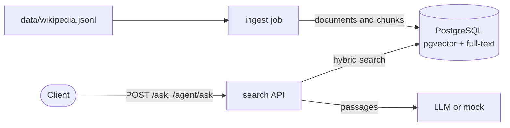
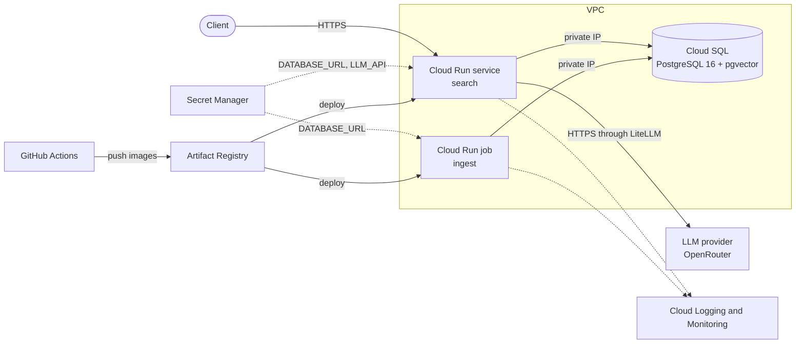

# Architecture

## Overview

Two services that share only the database:

- **ingest** writes. It turns the articles into embedded chunks, then exits.
- **search** reads. It answers questions from those chunks.

Locally, Docker Compose starts them in order: `db` (healthy) → `ingest` (finished) → `search`.

## How a question is answered

`POST /ask`:

1. FastAPI checks the body: a question of 1 to 1000 characters.
2. `FastEmbedEmbedder` turns `task: search result | query: <question>` into 768 numbers with
   EmbeddingGemma. It runs in a worker thread, so the server keeps handling other requests.
3. `PgVectorSearch` runs one SQL query with three parts:
   - `by_meaning`: the 20 chunks closest to the question by cosine distance (HNSW index)
   - `by_keywords`: the 20 best full-text matches (`websearch_to_tsquery`, GIN index)
   - `combined`: Reciprocal Rank Fusion. Each list gives a chunk `1 / (60 + rank)`, so a chunk
     ranked high in both lists wins. The top 4 come back with their cosine similarity.
4. `SearchDocs` drops passages with a similarity below `MIN_SCORE` (0.4).
5. `AskQuestion` picks one of two paths:
   - If nothing is left, it returns "I could not find information about that in the knowledge
     base." and does not call the LLM.
   - Otherwise `LiteLLMAdapter` sends the shared `ANSWER_PROMPT` and the numbered passages to
     `LLM_MODEL`, and to `LLM_FALLBACK_MODEL` if that fails.
6. The response holds the answer, the sources and `prompt_version`.

Why the search has two parts:

- **Embeddings** match meaning, so "who made it" finds "created by".
- **Full-text search** matches exact names and terms that an embedding can blur.
- **RRF** merges the two lists by rank, so their scores never have to be compared directly.

`POST /agent/ask` uses a Google ADK agent with two tools from `KnowledgeBaseTools`:

- **`search_knowledge_base(query)`** runs the same `SearchDocs` as `/ask`.
- **`list_documents()`** returns the document titles.

ADK reads each tool's name and docstring as its description. The agent can rewrite the query and
search again, up to `AGENT_MAX_LLM_CALLS` (6) LLM calls. The sources it returns are every passage
the tools found, each listed once. Each request gets a new in-memory session, and nothing is kept
between requests.

## How data is loaded

`ingest.py` handles each article in `data/wikipedia.jsonl` in these steps:

1. Hash the article text with SHA-256. If `documents` already has that hash, skip the article.
2. Delete the old row with the same `source`. `ON DELETE CASCADE` removes its chunks too. This is
   how a changed article gets replaced.
3. Insert the document.
4. Split the article into paragraphs of more than 80 characters, then hash each one. A single
   query finds which hashes `chunks` already holds, and those paragraphs are skipped. A paragraph
   repeated inside the same article is skipped too.
5. Embed only the new paragraphs as `title: <title> | text: <paragraph>` and insert them.

Both `content_hash` columns are `UNIQUE`, so the database refuses a duplicate even if the code
misses one. The whole run is one transaction: if any step fails, nothing is saved. The search
service never sees half an article. At the end, ingest prints how many documents and chunks were
new and how many were skipped.

## GCP deployment

| Service | Role |
|---|---|
| Cloud Run service (`search/`) | Runs the stateless API over HTTPS with autoscaling. It needs 2 GiB of memory: we measured 1.4 GiB with the model loaded. |
| Cloud Run job (`ingest/`) | Runs `ingest.py` apart from user traffic and exits. It is safe to run again at any time, because the hashes skip what is stored. It also loads the model, so give it 2 GiB too. |
| Cloud SQL for PostgreSQL 16 | Stores the documents and chunks, with the pgvector HNSW index and the full-text GIN index. It has automated backups. `db/init.sql` is applied once, for example with `psql` through the Cloud SQL Auth Proxy. |
| VPC | Cloud Run reaches Cloud SQL over private IP (Direct VPC egress). The database has no public IP. |
| Secret Manager | Holds `DATABASE_URL` and `LLM_API` and passes them to the containers as environment variables. |
| Artifact Registry | Stores the two images that CI builds. |
| GitHub Actions | Tests, builds and pushes the images, then deploys. It signs in to GCP with Workload Identity Federation, so no service account key is stored in GitHub. |
| LLM provider (OpenRouter) | Writes the answer from the passages. It is called through LiteLLM, so changing the provider or model only changes `LLM_MODEL`. |
| Cloud Logging and Monitoring | Logs, latency and error rate, with alerts. |

## Production readiness

**Availability**

- Cloud Run spreads instances across the zones of a region. A new revision only gets traffic
  once it has started.
- `lifespan` opens the database pool with `wait=True`. A revision that cannot reach the database
  fails to start and gets no traffic.
- Cloud SQL runs with regional HA: a standby in a second zone takes over automatically. It also
  has automated backups and point-in-time recovery.
- If the main LLM fails, LiteLLM uses the fallback model. A question with no match is answered
  without the LLM.

**Scalability**

- The API is stateless. Each instance only holds the pool and the model in memory; the data lives
  in Postgres. Any instance can serve any request, so Cloud Run can add instances freely.
- Each instance has its own pool. `max instances × DB_POOL_SIZE` must stay below the Cloud SQL
  `max_connections`. For example, 10 × 5 = 50, below 100.
- Embedding the question is the CPU-heavy part of a request. It runs on the instance's own CPU, so
  more traffic means more instances, not a bigger database.
- The HNSW index keeps vector search fast as the number of chunks grows. Ingest only embeds new or
  changed text, so reloading stays cheap.
- For a much bigger dataset, three changes:
  - read the data from Cloud Storage instead of the image
  - split the ingest job into several Cloud Run job tasks
  - add a Cloud SQL read replica for search

**Cost**

- **Cloud Run** charges per use and runs with `min-instances=0`, so it scales to zero and costs
  nothing when idle. The first request after an idle period waits for a cold start of about
  6 seconds, mostly loading the model. The image precompiles its Python files to keep that short.
- **Cloud SQL** is the fixed cost. Use the smallest tier without HA for the demo, and HA only in
  production.
- **Embeddings** run inside the container, so there is no per-request embedding API cost. The
  price is 2 GiB of memory per instance.
- **LLM:** the main model is free, and the fallback is a low-cost paid model. Questions with no
  match never call the LLM.
- **Limits:** a billing alert and a `--max-instances` cap bound the spend.

**Security**

- **Secrets:** there are none in the code or the images. `search/.dockerignore` keeps `.env` out
  of the image. On GCP, Secret Manager provides the secrets at runtime, and `search` holds them as
  `SecretStr`.
- **Network:** the database only has a private IP.
- **Least privilege:** each service account can only read its own secrets and connect to Cloud
  SQL. CI deploys through Workload Identity Federation instead of a stored key.
- **Containers:** both run as a non-root user (`app`). The search image is built in two stages,
  so uv and the lock files stay out of the image that runs.
- **Input:** questions are limited to 1000 characters. The LLM is told to answer only from the
  passages it is given.
- **Before real users:** add authentication (Cloud Run IAM or API Gateway) and rate limits in front
  of the public endpoint.
