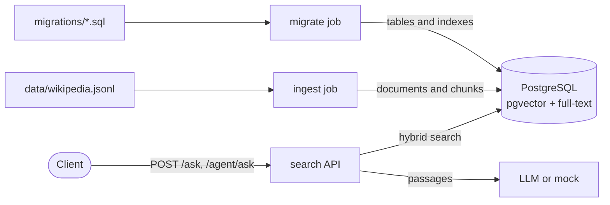
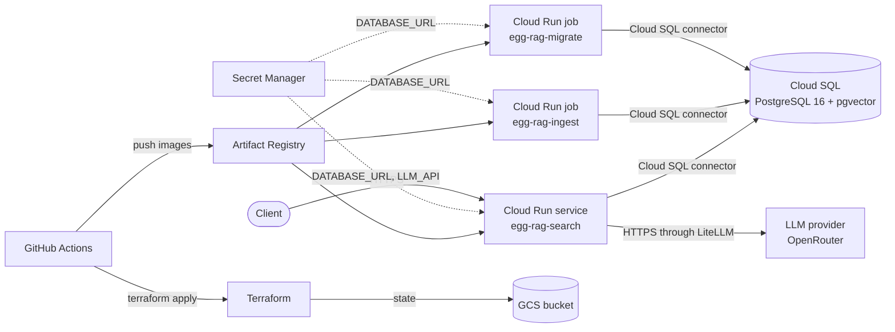

# Architecture

## Overview

Three programs that share only the database:

- **migrate** owns the schema. It applies new migration files, then exits.
- **ingest** writes. It turns the articles into embedded chunks, then exits.
- **search** reads. It answers questions from those chunks.

They always start in the same order: database → migrate → ingest → search. Docker Compose does
this locally, and the Deploy workflow does it on GCP.

## How the schema is created

`migrate.py` keeps a `schema_migrations` table with the name of every file it has applied. On
each run it applies the files in `migrations/` that are not in that table yet, in name order
(`001_...`, `002_...`), and adds each name to the table.

All of this happens in one transaction: if one file fails, none of them are applied. To change
the schema, add a new numbered file. Never edit one that has already run.

## How a question is answered

`POST /ask`:

1. The login middleware checks the Google JWT in the cookie (see Security). Then FastAPI checks
   the body: a question of 1 to 1000 characters.
2. `FastEmbedEmbedder` turns `task: search result | query: <question>` into 768 numbers with
   EmbeddingGemma. It runs in a worker thread, so the server keeps handling other requests.
3. `PgVectorSearch` runs one SQL query with three parts:
   - `by_meaning`: the 20 chunks closest to the question by cosine distance (HNSW index)
   - `by_keywords`: the 20 best full-text matches (`websearch_to_tsquery`, GIN index)
   - `combined`: Reciprocal Rank Fusion. Each list gives a chunk `1 / (60 + rank)`, so a chunk
     ranked high in both lists wins. The top 4 come back with their cosine similarity.
4. `SearchDocs` drops passages with a similarity below `MIN_SCORE` (0.4).
5. `AskQuestion` picks one of two paths:
   - If nothing is left, it returns "I could not find information about that in the knowledge
     base." and does not call the LLM.
   - Otherwise `LiteLLMAdapter` sends the shared `ANSWER_PROMPT` and the numbered passages to
     `LLM_MODEL`, and to `LLM_FALLBACK_MODEL` if that fails.
6. The response holds the answer, the sources and `prompt_version`.

Why the search has two parts:

- **Embeddings** match meaning, so "who made it" finds "created by".
- **Full-text search** matches exact names and terms that an embedding can blur.
- **RRF** merges the two lists by rank, so their scores never have to be compared directly.

`POST /agent/ask` uses a Google ADK agent with two tools from `KnowledgeBaseTools`:

- **`search_knowledge_base(query)`** runs the same `SearchDocs` as `/ask`.
- **`list_documents()`** returns the document titles.

ADK reads each tool's name and docstring as its description. The agent can rewrite the query and
search again, up to `AGENT_MAX_LLM_CALLS` (6) LLM calls. The sources it returns are every passage
the tools found, each listed once. Each request gets a new in-memory session, and nothing is kept
between requests.

## How data is loaded

`ingest.py` handles each article in `data/wikipedia.jsonl` in these steps:

1. Hash the article text with SHA-256. If `documents` already has that hash, skip the article.
2. Delete the old row with the same `source`. `ON DELETE CASCADE` removes its chunks too. This is
   how a changed article gets replaced.
3. Insert the document.
4. Split the article into paragraphs of more than 80 characters, then hash each one. A single
   query finds which hashes `chunks` already holds, and those paragraphs are skipped. A paragraph
   repeated inside the same article is skipped too.
5. Embed only the new paragraphs as `title: <title> | text: <paragraph>` and insert them.

Both `content_hash` columns are `UNIQUE`, so the database refuses a duplicate even if the code
misses one. The whole run is one transaction: if any step fails, nothing is saved. The search
service never sees half an article. At the end, ingest prints how many documents and chunks were
new and how many were skipped.

## GCP deployment

| Service | Role |
|---|---|
| Cloud Run service `egg-rag-search` | Runs the stateless API over HTTPS. It scales from 0 to 3 instances, with 1 vCPU and 4 GiB each. The model takes 1.4 GiB in the process, and Cloud Run also counts the model file it reads, so 2 GiB is not enough. |
| Cloud Run job `egg-rag-migrate` | Applies new migration files, then exits. |
| Cloud Run job `egg-rag-ingest` | Loads the data apart from user traffic, then exits. It is safe to run again at any time, because the hashes skip what is stored. It gets 2 vCPU and 4 GiB. At 2 GiB it ran out of memory on Cloud Run, although it fits in 2 GiB under Docker. |
| Cloud Storage bucket `egg-interview-models` | Holds the embedding model (1.2 GB), uploaded once. Cloud Run mounts it read-only at `/models` in the ingest job and the search service, so the model is not in any image and nothing downloads it. It is part of the one-time setup, so Destroy keeps it. |
| Cloud SQL for PostgreSQL 16 | Stores the documents and chunks, with the pgvector HNSW index and the full-text GIN index. Smallest tier (`db-f1-micro`), with daily backups. |
| Cloud SQL connector | Cloud Run's built-in connection to Cloud SQL. It is encrypted and checks the caller's IAM role (`cloudsql.client`). The database has a public IP but allows no networks, so this connector is the only way in. |
| Secret Manager | `database-url` is created by Terraform with a random password. `llm-api` is created once by hand. Both are passed to the containers as environment variables. |
| Artifact Registry | Stores the three images, each tagged with the Git commit it was built from. Without the model they are small: search 1 GB, ingest 0.5 GB, migrate 0.3 GB. |
| Terraform | Creates everything above from `infrastructure/`. Its state lives in a versioned GCS bucket, so every run starts from the same state, and a lock stops two runs at once. |
| GitHub Actions | `ci.yml` checks every push. `deploy.yml` and `destroy.yml` only run when you click them. They sign in to GCP with Workload Identity Federation, so no key is stored in GitHub. |
| LLM provider (OpenRouter) | Writes the answer from the passages. It is called through LiteLLM, so changing the provider or model only changes `LLM_MODEL`. |

What happens when you click Deploy:

1. `terraform apply` creates or updates the infrastructure. It sets the images only the first
   time, as placeholders, and never changes them after that, because the next steps own them.
2. Build and push the migrate image, point the migrate job at it, then run it and wait.
3. Do the same for ingest.
4. Build and push the search image and point the service at it. Cloud Run starts the new revision
   and moves traffic to it once it is ready.

If any step fails, the steps after it do not run. Search only ever runs against a schema and data
that are already in place.

## Production readiness

**Availability**

- Cloud Run spreads instances across the zones of a region. A new revision only gets traffic
  once it has started. If it fails to start, the old revision keeps serving.
- `lifespan` opens the database pool with `wait=True`. A revision that cannot reach the database
  fails to start and gets no traffic.
- The database is zonal, with daily backups. For production, set
  `availability_type = "REGIONAL"`: a standby in a second zone then takes over automatically.
- If the main LLM fails, LiteLLM uses the fallback model. A question with no match is answered
  without the LLM.

**Scalability**

- The API is stateless. Each instance only holds the pool and the model in memory; the data lives
  in Postgres. Any instance can serve any request, so Cloud Run can add instances freely.
- Each instance has its own pool of `DB_POOL_SIZE` (5) connections. `db-f1-micro` allows 25
  connections, so `max_instance_count` is 3: 3 × 5 = 15, plus 1 for a running job, stays below
  25. A bigger tier allows more instances.
- Embedding the question is the CPU-heavy part of a request. It runs on the instance's own CPU, so
  more traffic means more instances, not a bigger database.
- The HNSW index keeps vector search fast as the number of chunks grows. Ingest only embeds new or
  changed text, so reloading stays cheap.
- For a much bigger dataset, three changes:
  - read the data from Cloud Storage instead of the image
  - split the ingest job into several Cloud Run job tasks
  - add a Cloud SQL read replica for search

**Cost**

- **Cloud Run** charges per use and runs with `min-instances=0`, so it scales to zero and costs
  nothing when idle. The first request after an idle period waits for a cold start of about
  6 seconds, mostly loading the model from the bucket. The image precompiles its Python files to
  keep that short.
- **Cloud SQL** is the only fixed cost. It uses the smallest tier, and the connector adds nothing
  to the bill.
- **Destroy** removes everything Terraform created, including Cloud SQL, so a demo that is not in
  use costs nothing. Deploy brings it back with fresh data in a few minutes.
- **Embeddings** run inside the container, so there is no per-request embedding API cost. The
  price is 4 GiB of memory per instance, paid only while an instance runs. The model costs about
  3 cents a month to store in the bucket.
- **LLM:** the main model is free, and the fallback is a low-cost paid model. Questions with no
  match never call the LLM.
- **Limits:** a billing alert and the cap of 3 instances bound the spend.

**Security**

- **Secrets:** there are none in the code, the images or GitHub. The database password is random,
  made by Terraform and stored in Secret Manager. `search` holds secrets as `SecretStr`.
- **Terraform state:** it holds the database password, so the bucket has public access blocked.
  Only the deployer and the project's owners and editors can read it.
- **Network:** the database allows no networks. Only callers with `cloudsql.client` can connect,
  through the connector. For production, a private IP removes the public address too.
- **Least privilege:**
  - The jobs account can only use Cloud SQL and read `database-url`.
  - The search account can also read `llm-api`.
  - GitHub can only sign in as the deployer from this repository's `main` branch.
- **Containers:** all three run as a non-root user (`app`). The search image is built in two
  stages, so uv and the lock files stay out of the image that runs.
- **Login:** a middleware guards every route except the login page, including the ADK web UI and
  `/docs`. A request needs a JWT from Sign in with Google, in an `HttpOnly`, `Secure`,
  `SameSite=Lax` cookie. On every request the service checks four things:
  - **Signature:** made by Google, checked against Google's public keys, which are cached for
    5 minutes
  - **Audience:** our client ID
  - **Issuer:** Google
  - **Account:** the email is `ALLOWED_EMAIL` and verified

  The JWT expires after one hour. There is no server-side session to steal or keep in sync. The
  app refuses to start without `ALLOWED_EMAIL` and `GOOGLE_CLIENT_ID`, so login cannot be
  switched off by a missing value. The Google sign-in app stays in Testing mode with one test
  user, a second lock on top of `ALLOWED_EMAIL`.
- **Input:** questions are limited to 1000 characters. The LLM is told to answer only from the
  passages it is given.
- **Before more users:** add rate limits in front of the service.
